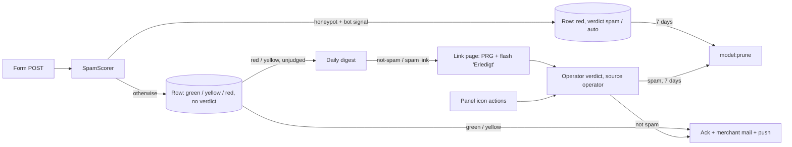

# Slice 030 — Spam Test Follow-ups

> Completed: 2026-10-14
> Commits: 7a21997..09d5db6 (branch epic-003-spam-handling, folded into PR #87)
> Epic: [epic-003 — Spam Handling](./epic-003-spam-handling.md)

## What

Closes the findings of the human's local hands-on test of PR #87. The live campaign's unambiguous bot pattern —
honeypot filled **plus** a second bot signal (ancient browser, filled too fast, missing render token, gibberish) — is
sorted out on store as "Spam (automatisch)": no mail, not in the digest, pruned after 7 days, still correctable to
"not spam". The panel's row actions are icon buttons with tooltips and state colours; the digest also lists the open
suspected (yellow) rows with a "mark as spam" link; the mail-link page confirms a successful click instead of reading
as "already used"; the panel login shows German messages (laravel-lang); CI guards the committed Filament assets; the
dev `queue` / `scheduler` run. Phase-5 additions: the triage labels read "Ihre Entscheidung" / "Entscheidung am", and
the spam simulation runs as a Pest integration test (`SpamSimulationTest`) with every check.

## Why

- A human can fill the honeypot (password manager, DOM-reading AI agent), but then with a current browser and a human
  fill time; the live campaign always came with an ancient browser (19/19). So the honeypot alone stays red/unjudged
  and only the combination is definite. Network signals are excluded (customers abroad / behind VPNs).
- Auto-sorted rows feed neither memory: learning only from the operator's own verdicts, so a misfire cannot amplify
  itself.
- The other items are direct test findings: missing yellow rows in the digest, a misleading link page, translation
  keys on the login, stale Filament assets that broke the dev login, dev workers on the prod DB path.

### Walk-through

On submit the scorer sums the signals as before and additionally checks the auto-sorting rule
(`revoco.spam.auto_confirm`); a match stores the row with verdict spam / source `auto` — never rejected. Red routing
withholds acknowledgment, merchant mail and push; the row sits in the Spam tab and `model:prune` deletes it after 7
days unless the operator corrects it (then the acknowledgment goes out, source `operator`). The daily digest collects
the unjudged red rows (with "not spam" links) and the unjudged yellow rows (with "mark as spam" links) of the last 24
h. A link POST applies the verdict and flashes it, so the page after the redirect says "Erledigt: …"; a reload or a
stale link shows "already used". In the panel all four row icons stay visible (`WithdrawalActions::row()`): the
current state is coloured, actions that would change nothing are disabled.

## Decisions

- **Routing** — one follow-up slice on the epic branch, folded into the open PR #87; the live preview (CR3) is its own
  slice afterwards. *Why not* a stacked PR: small follow-ups belong in the open base PR.
- **Network signals stay** — the live-campaign replay showed they push the campaign's Fiba-Cloud submits to red
  without the honeypot. *Why not* remove them: their weight is small but decisive for the bot fingerprint.
- **Auto-sorting rule** — honeypot plus one of `user_agent_ancient`, `fill_time_too_fast`, `render_token_invalid`,
  `content_gibberish`. *Why not* honeypot alone: password managers and AI agents can fill it.
- **No memory feeding from auto rows** — only operator verdicts teach the abused-address and learned-network
  memories. *Why not* learn from both: a misfire would reinforce itself.
- **Auto-sorted rows pruned after 7 days** — like operator-confirmed spam; `rules.md` Tabus amended (promoted [R]).
- **Verdict source as its own column** (`spam_verdict_source`: auto | operator). *Why not* a third verdict value:
  `SpamVerdict` and every existing query stay unchanged.
- **Honeypot keeps the name `website`** and gains `data-1p-ignore`, `data-lpignore="true"`, `data-bwignore`,
  `data-form-type="other"` (vendor docs checked 2026-10-14). *Why not* rename it: bots target exactly that name.
- **Icon actions** — icon-only buttons with tooltips, the current state coloured, actions that would change nothing
  disabled (always visible, not hidden); view-page header and bulk actions unchanged. *Why not* toggles: a switch
  cannot show the unjudged state.
- **Digest yellow section** — unjudged yellow rows of the last 24 h with a "mark as spam" link; sent when red **or**
  yellow rows exist; the panel link goes to the inbox when only yellow rows exist. Digest and link-page copy stay
  German only, like all operator mail copy.
- **Spam-link success** — flashed only when the verdict actually changed (`SpamLinkAction::applyTo()` returns bool);
  the `state` single-use guard is unchanged.
- **German framework messages from laravel-lang** (`laravel-lang/common` ^6.8, dev dependency; files committed,
  Pint-formatted; the project's own `lang/de/*` untouched; English falls back to the framework's built-in files).
  Build rule promoted to `rules.md` [R].
- **Filament asset drift guarded in CI** — `filament:assets` + `git status --porcelain` (catches new untracked files
  too). Build rule promoted to `rules.md` [R].
- **Delivery wording in `rules.md`** — "ack-always" replaced by "acknowledgment per spam level" (promoted [R]; stale
  since slice-026).
- **Dev workers** — the override's dev-worker anchor sets `APP_ENV=local` and the dev `DB_DATABASE`.
- **Phase 5 (human)** — [W]; added the "Entscheidung" labels and `SpamSimulationTest` (8 scenarios + throttle burst,
  abused-address repeat, a simulated day through the digest; MaxMind fixtures + Tor/DROP feed files, no real IPs).
- **Phase 7 refactors (human-picked)** — test user agents in `tests/Pest.php`; the link page's status via
  `Withdrawal::verdictLabel()`; `SpamActions` → `WithdrawalActions` holding the whole icon row.
- **Phase 8** — round 1 clear: 4 Light local fixes in-phase (asset staging, a stronger login-message test,
  `design/spam-handling.md` round 5, comment style), 1 Light follow-up (below).

## Commits

- `7a21997` — feat(spam): auto-sort honeypot submits with a second bot signal
- `6b8503c` — feat(panel): icon-button row actions and automatic-spam label
- `16cce70` — feat(form): keep password managers out of the honeypot
- `48c4681` — feat(digest): list suspected withdrawals in a section of their own
- `623deb2` — fix(spam-link): confirm an applied verdict after the redirect
- `3bdbd0d` — feat(i18n): add German framework messages from laravel-lang
- `e9af810` — build(filament): republish assets and guard them in CI
- `a1db53b` — chore(docker): point the dev workers at the dev database
- `c97f579` — test(spam): replay the spam scenarios end to end
- `e1ec20a` — docs(design): record the auto-sorting round of the spam design
- `09d5db6` — docs(roadmap): note the shop integration idea

## Follow-ups

- R1-5 Light · Rethink · An auto-sorted row never reaches the operator outside the panel (no mail, not in the digest,
  purged after 7 days); a customer on an old device whose built-in browser autofill fills the off-screen honeypot
  would be lost unnoticed — the rationale covers password managers on current browsers only; product decision (e.g. a
  count-only "N automatically sorted out, deleted on …" line in the digest).

## How (Diagram)

